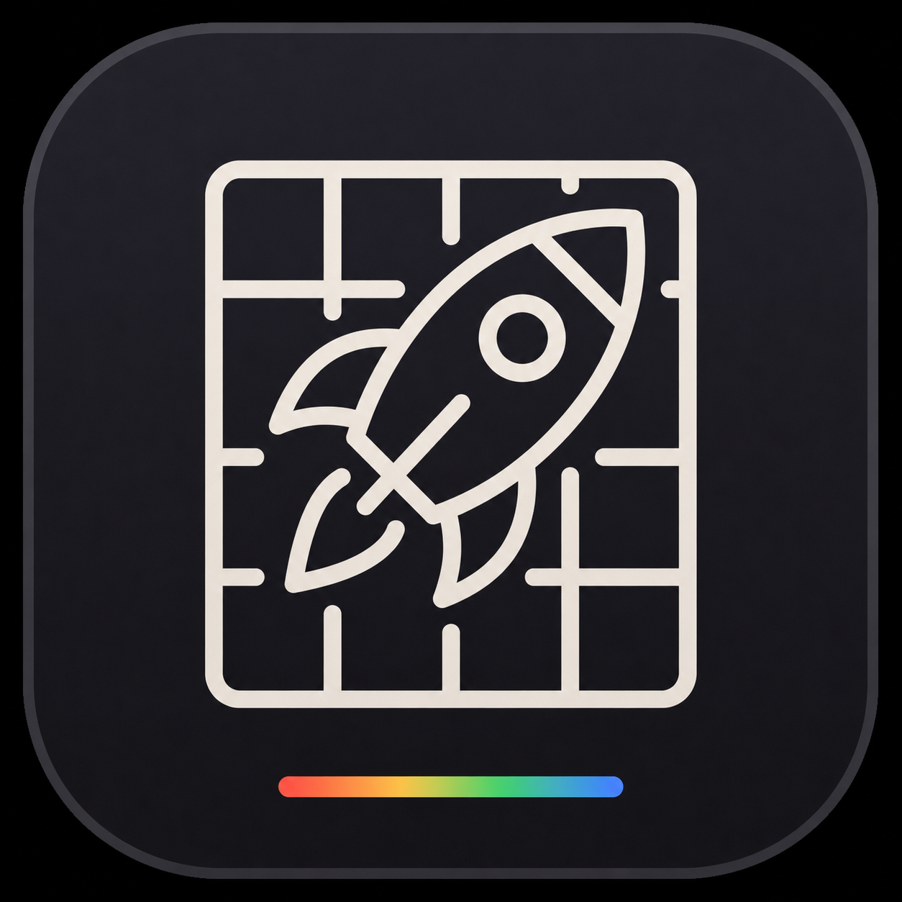

# Xe Computer

<p align="center">
  
</p>

Xe Computer is a local development environment for web apps on Apple Silicon
Macs running macOS Tahoe. This repository contains Xe Launcher, the menu bar
app that manages the browser, Xe Computer IWA, and container environment.

This is experimental software. Use disposable projects and browser accounts.

## Install

Download the [latest release](https://github.com/Agent54/xe-computer-launcher/releases/latest)
and open the DMG to install Xe Launcher.

## Architecture

The browser and container environment have independent lifecycles:

- **macOS launcher:** owns installation, permissions, updates and supervision.
- **Helium and the Xe Computer IWA:** provide the application UI and browser
  runtime, independently of the container VM.
- **Host Compose server and Workerd:** keep the UI, management API and local
  routing available while the VM restarts or is unavailable.
- **SmolVM:** runs Docker and the guest Workerd router. The host reaches guest
  services through Unix sockets rather than exposing their management ports.

See [gateway architecture and development](workerd/README.md) for routing,
TLS and browser automation boundaries.

## Storage and trust boundaries

The selected Compose folder is shared with the VM at `/stacks`. Compose file
discovery and builds run on the Mac; host bind mounts are translated into that
shared tree. Project paths and bind sources must remain inside it, including
symlink targets. **Compose files are still trusted host input:** env files,
includes and build contexts can read outside the shared folder. These path
checks are not a sandbox for untrusted projects.

Launcher state, browser profiles and VM disks live under
`~/Library/Application Support/dev.xe.computer`, separately from projects.
Changing the Compose folder does not migrate existing projects. VM disks can
grow but cannot shrink. Uninstall archives launcher data under that directory's
`archive/` folder; external Compose projects are preserved.

Hold Option when opening the tray menu for **Restart Xe** and **Uninstall…**.
Both require verified shutdown of every component. Uninstall retains earlier
archives and moves the approved launcher bundle to Trash. A shared lifecycle
lock excludes other launcher copies during runtime and uninstall. Restart keeps
the every-launch experimental-software prompt; choose **Continue** to start
components again.

Container startup is owned by the host coordinator rather than Docker's
boot-time restart mechanism. An explicit startup list and requests for an app
can start services without bringing up unrelated replicas or dependencies.

The launcher automatically prunes unused images and build cache, including
more recent cache under critical disk pressure. Unused tagged images are not
durable storage. Containers and volumes are preserved. Docker's size-budget
build-cache GC is disabled because its overlay2 scan can exhaust VM memory;
launcher maintenance uses age-based pruning instead.

## Local networking

Compose UI and apps share HTTP/HTTPS listeners: either 80/443 or 5196/5194.
The UI is at `compose-ui.localhost`; service and port-selector hostnames are
documented in [port routes](workerd/README.md#port-routes). Port 8094 is private
management, not an alternative application listener.

Ports 80/443 require administrator approval for a small `launchd` socket
helper; Workerd itself remains unprivileged. HTTPS for the UI and HTTP app
aliases requires trusting a per-installation local CA for the current user.
That trust affects other browsers in the same account. Containers serving
their own HTTPS retain responsibility for their certificates.

For custom listener ports, edit `app_http_port` and `app_https_port` in
`~/Library/Application Support/dev.xe.computer/settings.json` and restart the
launcher. Use either the 80/443 pair or two ports above 1023.

## Building from source

Follow the [development setup](https://github.com/Agent54/xe-darc/blob/main/INSTALL.md).
You also need Deno 2, Python 3, and an authenticated GitHub CLI with read access
to `Agent54/smol-compose`, `Agent54/compose-server`, and `Agent54/compose-ui`.

Local macOS builds need the Linux ARM64 `guest-worker` artifact from a CI run
for the same source revision:

```sh
make -C macos BUILD_CONFIG=debug GUEST_ROUTER_ASSET_DIR=/path/to/guest-worker bundle
```

`make` and `make bundle` prepare components once, build and run the runtime tests,
then package the tested launcher using the same `BUILD_CONFIG` (release by
default). Use `make -C macos BUILD_CONFIG=debug test` for host tests only.

This ordering does not itself clean previous local outputs. CI uses a clean
checkout and the guest-worker artifact from the same workflow run. The self-hosted
Mac still supplies its toolchains and retained macOS permissions; optional VM
tests can be skipped when their prerequisites are unavailable.

Component builds normally use checksum-pinned releases. To work across repos,
pass these overrides to `make`:

| Override | Local source |
| --- | --- |
| `COMPOSE_UI_SOURCE_DIR` | Compose UI checkout, such as `/path/to/darc-worker/svelte` |
| `COMPOSE_SERVER_SOURCE_DIR` | Compose backend checkout; requires Go |

See [worker development](workerd/README.md), [DevTools vendoring](devtools/README.md)
and [macOS integration testing](macos/Tests/Integration/README.md).

## Updates

Launcher releases use Sparkle; maintainers should follow the
[updater and release guide](macos/UPDATES.md).

The browser and IWA have independent release versions, pinned in
`macos/Sources/macos/Resources/sources.json`. IWA updates must preserve their
real, monotonically increasing manifest versions: Chromium owns the profile
registry, so updates replace the verified bundle while the browser is stopped
rather than patching that registry.
